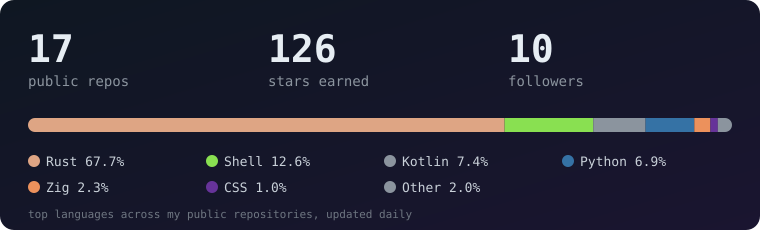

 

## About

I write **Simple Linux**, a small distribution on top of Gentoo, and the Linux tools around it, mostly in **Rust**: an installer, an app
installer, an app store for Portage, terminal helpers, a screen streamer. I also keep notes and write docs about how it all works.

- Gentoo and OpenRC on a laptop I tune myself (kernel, power, GPU), so the tools come from things I actually needed.
- Programs in the same family look alike: GTK4 and libadwaita, one language setting, English by default.
- Every project has screenshots and a README that says what was tested and what was not.

## What I am building

<table>
  <tr>
    <td width="50%"></td>
    <td width="50%"></td>
  </tr>
  <tr>
    <td valign="top"><b><a href="https://github.com/tarilka0gg/simple-linux">Simple Linux</a></b> A small Gentoo-based live system with its own installer: online and offline ISOs, a kernel matched to your hardware, niri and Noctalia.</td>
    <td valign="top"><b><a href="https://github.com/tarilka0gg/gentoo-installer">Installer</a></b> Text and GTK4 frontends over one Rust core. Flavors, software groups, screenshots of every program, resume after a failure.</td>
  </tr>
  <tr>
    <td width="50%"></td>
    <td width="50%"></td>
  </tr>
  <tr>
    <td valign="top"><b><a href="https://github.com/tarilka0gg/ustan">ustan</a></b> A Windows-style app installer for Linux: .deb, .rpm, AppImage, snap, Flatpak, .exe. No root, clean uninstall.</td>
    <td valign="top"><b><a href="https://github.com/tarilka0gg/portage-store">Portage Store</a></b> An app store for Gentoo Portage: browse, search, USE flags, updates, a CLI companion on the same core.</td>
  </tr>
  <tr>
    <td width="50%"></td>
    <td width="50%"></td>
  </tr>
  <tr>
    <td valign="top"><b><a href="https://github.com/tarilka0gg/tui-shim">tui-shim</a></b> Terminal apps that behave like desktop apps: launchers, icons, palette theming and a file picker for editors.</td>
    <td valign="top"><b><a href="https://github.com/tarilka0gg/Ring-2Zero">Ring-2Zero</a></b> A Wayland screen streamer over WebRTC with tile-based diff encoding: your desktop in a browser tab.</td>
  </tr>
</table>

## Stack

         

## Numbers

## More repositories

| Repository | What it is | |
|---|---|---|
| [**simple-locale**](https://github.com/tarilka0gg/simple-locale) | One language setting for all my programs: a shared locale.toml, English by default. |  |
| [**simple-linux-binhost**](https://github.com/tarilka0gg/simple-linux-binhost) | Signed binary packages Gentoo's own binhost lacks: niri, Noctalia, ghostty. |  |
| [**simple-linux-configs**](https://github.com/tarilka0gg/simple-linux-configs) | Clean default configs for niri, Hyprland, Sway, Labwc, MangoWC, dwl and more, paired with Noctalia. |  |
| [**kernel-matrix**](https://github.com/tarilka0gg/kernel-matrix) | A matrix of Linux kernel configs: CPU x GPU x platform x EC x modem, merged from Kconfig fragments. |  |
| [**telegram-helper-rs**](https://github.com/tarilka0gg/telegram-helper-rs) | A Rust rewrite of a Telegram helper: userbot, control bot, localhost dashboard, Zig SIMD helpers. |  |
| [**system-lab**](https://github.com/tarilka0gg/system-lab) | Laptop lab notes: BIOS unlock, undervolting, RAPL/EC turbo, Clang + AutoFDO kernel builds. |  |
| [**power-scripts**](https://github.com/tarilka0gg/power-scripts) | Deep-idle power management scripts for a Victus 16 laptop (OpenRC, niri). |  |
| [**gpu-undervolt**](https://github.com/tarilka0gg/gpu-undervolt) | NVIDIA laptop GPU clock offset at boot through a throwaway headless Xorg. |  |

## Say hi

Issues and ideas are welcome in any repository above. Releases and release notes live in
[Simple Linux releases](https://github.com/tarilka0gg/simple-linux/releases).

The terminal at the top is an animated SVG; the numbers card is rebuilt every day by <code>scripts/update_stats.py</code> in a GitHub Action.
